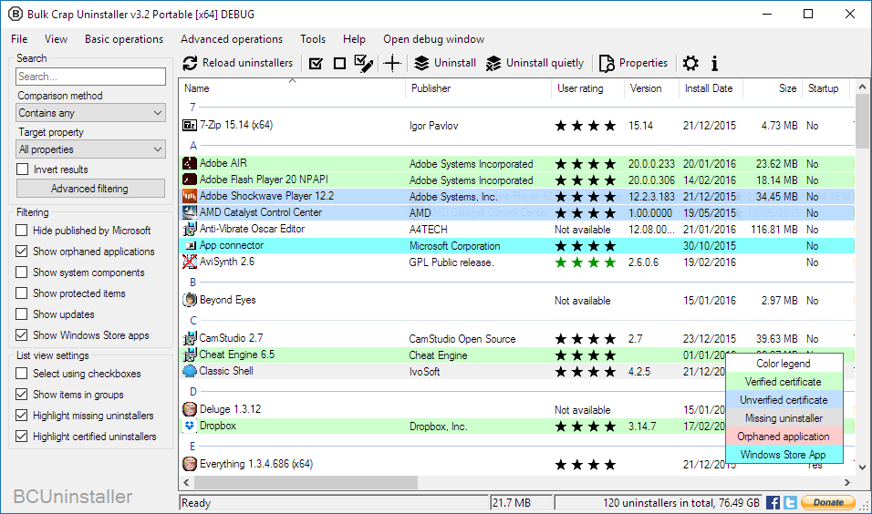
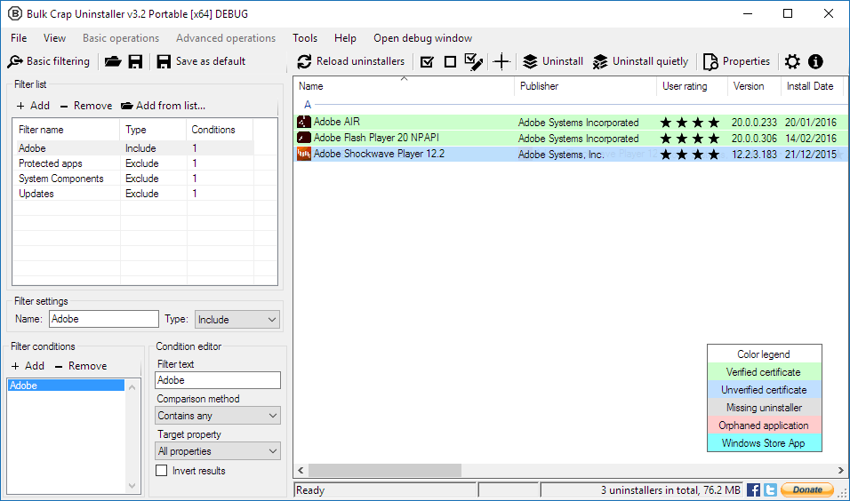
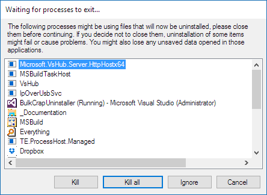
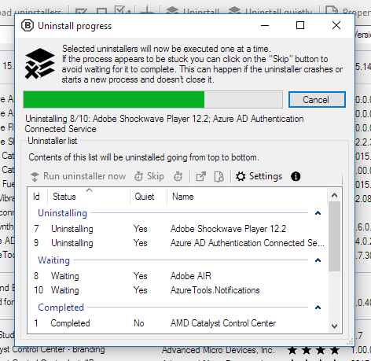
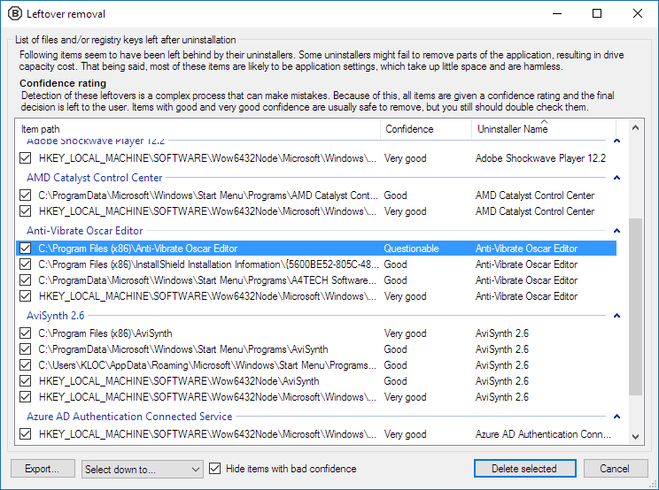

- [1 介绍](#1-介绍)
  - [1.1 系统要求](#11-系统要求)
- [2 主窗口](#2-主窗口)
  - [2.1 应用程序列表](#21-应用程序列表)
    - [2.1.1 突出显示颜色](#211-突出显示颜色)
    - [2.1.2 证书和验证](#212-证书和验证)
    - [2.1.3 用户评分](#213-用户评分)
  - [2.2 左侧边栏](#22-左侧边栏)
  - [2.3 矩形树图](#23-矩形树图)
  - [2.4 功能](#24-功能)
    - [2.4.1 卸载 / 静默卸载](#241-卸载--静默卸载)
    - [2.4.2 使用 MsiExec / Windows Installer 卸载](#242-使用-msiexec--windows-installer-卸载)
    - [2.4.3 手动卸载](#243-手动卸载)
    - [2.4.4 清理“Program Files”文件夹](#244-清理program-files文件夹)
    - [2.4.5 通过窗口查找](#245-通过窗口查找)
    - [2.4.6 卸载 Windows 功能](#246-卸载-windows-功能)
- [3 应用程序属性](#3-应用程序属性)
  - [3.1 卸载程序丢失](#31-卸载程序丢失)
  - [3.2 未注册的应用程序](#32-未注册的应用程序)
  - [3.3 受保护](#33-受保护)
  - [3.4 商店应用](#34-商店应用)
  - [3.5 系统组件](#35-系统组件)
  - [3.6 更新](#36-更新)
- [4 设置](#4-设置)
  - [4.1 卸载](#41-卸载)
    - [4.1.1 同时卸载](#411-同时卸载)
- [5 高级复制到剪贴板](#5-高级复制到剪贴板)
- [6 高级筛选 / 卸载列表](#6-高级筛选--卸载列表)
  - [6.1 启用高级筛选](#61-启用高级筛选)
  - [6.2 筛选器](#62-筛选器)
  - [6.3 条件](#63-条件)
    - [6.3.1 比较方法](#631-比较方法)
    - [6.3.2 目标属性](#632-目标属性)
  - [6.4 通过 .bcul 文件保存和加载筛选器](#64-通过-bcul-文件保存和加载筛选器)
- [7 卸载](#7-卸载)
  - [7.1 显式 / 静默卸载程序](#71-显式--静默卸载程序)
  - [7.2 准备工作](#72-准备工作)
    - [7.2.1 进程终止窗口](#721-进程终止窗口)
  - [7.3 卸载进度窗口](#73-卸载进度窗口)
    - [7.3.1 手动控制、处理卡住的卸载程序](#731-手动控制处理卡住的卸载程序)
    - [7.3.2 中断整个卸载任务](#732-中断整个卸载任务)
  - [7.4 残余 / 垃圾删除](#74-残余--垃圾删除)
    - [7.4.1 置信度](#741-置信度)
    - [7.4.2 备份](#742-备份)
- [8 自定义规则、脚本和调整](#8-自定义规则脚本和调整)
  - [8.1 脚本文件规范](#81-脚本文件规范)
    - [8.1.1 脚本文件示例（remove-onedrive.xml）](#811-脚本文件示例remove-onedrivexml)
    - [8.1.2 标准元素](#812-标准元素)
    - [8.1.3 可用值](#813-可用值)
    - [8.1.4 特殊元素](#814-特殊元素)
- [9 命令行选项](#9-命令行选项)
  - [9.1 BCUninstaller.exe](#91-bcuninstallerexe)
  - [9.2 BCU-console.exe](#92-bcu-consoleexe)
  - [9.3 StoreAppHelper.exe](#93-storeapphelperexe)
  - [9.4 SteamHelper.exe](#94-steamhelperexe)
  - [9.5 OculusHelper.exe](#95-oculushelperexe)
  - [9.6 UninstallerAutomatizer.exe](#96-uninstallerautomatizerexe)

# 1 介绍

Bulk Crap Uninstaller（简称 BCU）是一款自由的（指自由软件意义上的“自由”）程序卸载工具。它擅长在用户输入最少的情况下删除大量应用程序。它可以清理残余内容、检测孤立（孤儿）应用程序、按预先制作好的列表运行卸载程序，还有更多功能！

BCU 与 Windows 商店应用、Steam、Windows 功能完全兼容，并对许多卸载系统（NSIS、InnoSetup、Msiexec 以及许多其他系统）提供特殊支持。完整的功能列表见下。

Bulk Crap Uninstaller 以 Apache 2.0 开源许可证授权，在私人和商业环境中均可免费使用，且不附带任何义务，只要不违反该许可证的任何条款即可。

官方网站和联系表单见 https://www.bcuninstaller.com/

获取最新版本或查看代码见 https://github.com/Klocman/Bulk-Crap-Uninstaller

## 1.1 系统要求

- 操作系统：推荐 Windows Vista 或更高版本。BCU 也能在 XP 和 2003 上运行，但功能较少，且可能有些 bug。支持 32 位和 64 位版本。
- .NET：推荐 .NET 4.0 或更高版本；在仅有 .NET 3.5 的环境中也能运行，但功能会减少。
- 内存：约 300MB 或更多的可用 RAM。
- CPU：基本无关紧要。
- 可用空间：50MB 或更多。
- 硬盘：任何硬盘都可以，但较慢的驱动器会使扫描时间按比例延长。

BCUninstaller **需要管理员权限**才能启动和运行。管理员权限用于在应用程序扫描期间访问某些系统功能、卸载应用程序以及删除残余内容。某些其他功能可能也需要提升权限才能运行，因此无法以普通用户权限运行 BCU。

# 2 主窗口



## 2.1 应用程序列表

BCU 设法在系统中找到的应用程序列表占据了主窗口的大部分。列表可以按列排序，并使用左侧的选项进行筛选。

### 2.1.1 突出显示颜色

默认情况下，列表中的许多项会根据其属性带有彩色背景。它们的含义可以在右下角的颜色图例中找到。如果该图例不可见，可以从“视图”菜单中启用它。

白色背景的项没有特殊属性。

### 2.1.2 证书和验证

BCU 可以读取并验证卸载程序的证书。它们的详细信息可在“属性”窗口中查看。此功能**并非**用于判断应用程序的好坏，仅作为提示使用。

已验证的证书意味着该可执行文件保证自离开发布者之后未被以任何方式修改过。

以下情况可能导致证书验证失败：

- 由于根证书无效或无法连接 Internet，无法验证证书。
- 可执行文件在某个时刻被以某种方式修改过。这对 Windows Installer（MSI/MsiExec）卸载程序来说是正常的——系统会修改它们以节省磁盘空间。
- 证书是自签名的，因此无法验证。
- 已签名的文件在通过网络传输的过程中被修改或损坏。

### 2.1.3 用户评分

大多数应用程序都可以由 BCU 的用户进行评分。评分会自动与统计服务器同步。等级介于 0 到 4 颗星之间，星星的颜色与数量相对应。

如果星星是黑色的，说明它们代表你自己的投票，而不是用户的平均值。你可以在星星上悬停以查看平均评分。

## 2.2 左侧边栏

设置侧边栏主要包含应用程序列表的筛选选项。它可以从“视图”菜单中隐藏。

搜索框与高级筛选中使用的条件相同，详情见 [6.3 条件](#63-条件)。

如果启用了高级筛选，侧边栏会自动隐藏。

## 2.3 矩形树图

在窗口底部、状态栏的正上方，你应该会看到一堆彩色图块。这是一个矩形树图（treemap）——当前列表中所有可见应用程序的可视化表示。

方块的大小基于应用程序的估计大小。如果应用程序没有估计大小，则不会显示。图块采用非线性算法缩放——大小差异看起来会比实际更小。

你可以将鼠标悬停在矩形树图上，光标下的应用程序会显示在下方。你可以右键单击任意图块打开上下文菜单，左键单击以选择应用程序。它的工作原理与主列表相同。选中的图块会变为选中色。

## 2.4 功能

### 2.4.1 卸载 / 静默卸载

开始卸载选定的应用程序。静默卸载意味着你不必点击任何东西——过程全自动完成。如果某些项目无法静默卸载，将显示一个对话框，可从选择中移除“显式”卸载程序。

### 2.4.2 使用 MsiExec / Windows Installer 卸载

如果应用程序附带了产品代码/GUID，可以尝试使用 MsiExec 卸载它。这并不能保证对所有应用程序都有效。

### 2.4.3 手动卸载

跳过运行卸载程序（如果可用），改为提供一个文件和注册表项列表，由你选择手动删除。

除非无法以其他方式卸载应用程序，否则不建议使用此方法。

### 2.4.4 清理“Program Files”文件夹

搜索所有被定义为默认安装位置的文件夹（通常仅是 Program Files 文件夹）以查找残余内容。这包括空文件夹和部分卸载的应用程序。你会得到一份可选删除的项目列表。

### 2.4.5 通过窗口查找

打开一个小工具窗口。将十字准星拖放到要扫描的窗口上。BCU 会尝试查找拥有指定窗口的应用程序，并将其显示在列表中。

### 2.4.6 卸载 Windows 功能

扫描系统中已安装的 Windows 功能，并将其添加到应用程序列表。此后它们会被当作普通应用程序处理，可以批量卸载。扫描可能需要一段时间。

# 3 应用程序属性

某些属性以背景色显示，详情见 [2.1.1 突出显示颜色](#211-突出显示颜色)。

列表中未显示的其他信息可在“属性”窗口中查看。

## 3.1 卸载程序丢失

应用程序已在系统注册表中注册，但其卸载程序已损坏或丢失。必须手动删除。

## 3.2 未注册的应用程序

应用程序未在系统注册表中注册，但存在于驱动器上。如果应用程序仍有可用的卸载程序，BCU 通常能找到它并让你运行。如果找不到卸载程序，BCU 会自动生成一个简单的卸载程序。

## 3.3 受保护

应用程序在系统注册表中被标记为受保护。这通常用于表示它是另一个包的一部分，或者是其他应用程序所需要的。

## 3.4 商店应用

新的 Windows 10 风格应用程序都被称为商店应用，即使它们并非来自 Windows 商店。它们通常需要完全不同的卸载方法，但 BCU 将其作为普通应用处理。

## 3.5 系统组件

应用程序被标记为在某种程度上对系统很重要。驱动程序和大型软件包的组件常被标记为系统组件，以便对用户隐藏。它们实际上并非操作系统所必需。

## 3.6 更新

表示该项是对另一个应用程序或操作系统的更新。卸载实际应用程序通常会一并删除所有相关更新。

# 4 设置

设置会在应用程序退出时自动应用并保存。可以通过“帮助\重置设置”菜单选项，或删除 BCU 目录中的“BCUninstaller.settings”文件，将设置重置为默认值。

## 4.1 卸载

- 阻止关机/重启：会尝试阻止卸载程序重启系统。
- 智能卸载程序排序：会在批量卸载期间对应用程序排序以加快进程。它会先处理显式卸载程序，以便你能更早离开计算机。
- 禁用保护：将停止阻止受保护的应用程序被卸载。
- 打开“模拟卸载”后，BCU 不会卸载或从系统中删除任何内容。

### 4.1.1 同时卸载

同时卸载是一项实验性功能，会安排多个卸载程序同时运行。它会尽最大努力防止任何冲突，有时此功能会完全不可用。

除非你使用的是高速 SSD，否则不建议同时运行两个以上的卸载程序。

你可以从“批量卸载”窗口中手动强制卸载程序并发运行。这样做时仍会进行冲突检测，但可以禁用该检查（不推荐）。

# 5 高级复制到剪贴板

模式是[复合格式字符串](https://msdn.microsoft.com/en-us/library/txafckwd(v=vs.110).aspx)，写入时会自动处理。

要启用转义字符（\r、\t、\n 等），请勾选“转义”复选框。它会将任何转义字符转换为非转义形式。

要插入换行符，请将“\r\n”（Windows 上的标准换行符）添加到模式中并勾选“转义”。你应该会看到换行符出现在结果框中。

组合框包含可以添加到模式的所有可用变量。选择其中一个变量会自动将其粘贴到光标位置。

# 6 高级筛选 / 卸载列表



## 6.1 启用高级筛选

可以通过单击侧边栏上的“高级”按钮，或从“文件”菜单打开现有的卸载列表来启用高级筛选。

如果加载了卸载列表，其路径会显示在应用程序的标题栏中。

启用高级筛选后，所有基本筛选设置都会被忽略。

## 6.2 筛选器

筛选器显示在“筛选器列表”中。每个筛选器可以包含多个条件。

可以通过工具栏上的选项从现有卸载列表中添加筛选器。新筛选器会追加到列表末尾。

如果筛选器的类型设为包含（Include），则只允许与它所有条件都匹配的应用程序出现在列表中。包含筛选器先于排除筛选器执行。

如果类型设为排除（Exclude），该筛选器会将与其所有条件都匹配的所有应用程序从列表中移除。排除筛选器会覆盖包含筛选器。

如果只有排除筛选器，则所有应用程序都会自动被包含。

## 6.3 条件

要让筛选器匹配某个应用程序，它的所有条件都必须匹配。只要有任何一个条件不匹配该应用程序，整个筛选器即匹配失败。

筛选器文本会使用选定的比较方法与目标属性进行比较。比较结果可以选择反转（取反）。

### 6.3.1 比较方法

- 包含 – 属性包含整个筛选器文本。
- 包含任一 – 属性包含筛选器文本中的任意一个词，词之间以空格分隔。
- 完全相同 – 属性与筛选器文本完全相同。
- 开头是 / 结尾是 – 属性以筛选器文本开头或结尾。
- 正则表达式 – 使用正则表达式引擎将筛选器文本与属性匹配。[正则表达式在线手册](http://www.regular-expressions.info/)。

### 6.3.2 目标属性

用于比较的应用程序属性。“所有属性”会尝试将筛选器文本与任何可用属性匹配。

可以通过查看应用程序的属性来预览这些属性。

## 6.4 通过 .bcul 文件保存和加载筛选器

.bcul 文件（也称为“高级筛选器列表”或“卸载列表”）用于存储高级筛选信息以供以后使用。你可以将一组筛选器保存到 .bcul 文件中，之后配合命令行工具，自动卸载与该筛选器匹配的所有应用程序。

要保存 .bcul 文件，请先打开“高级筛选”面板，指定筛选器，然后单击筛选器列表上方工具栏中的“另存为…”按钮。你应该会看到一个扩展名为 .bcul 的保存文件对话框。

要加载 .bcul 文件，可以单击“文件” > “打开卸载列表…”，或打开“高级筛选”面板并单击“打开…”工具栏项。

要配合命令行工具使用 .bcul 文件自动卸载应用程序（例如在脚本中），请参阅 [BCU-console.exe 参数列表](#92-bcu-consoleexe)。

# 7 卸载

BCU 可以卸载单个应用程序，也可以同时卸载多个。要卸载，请在主列表中选择要卸载的应用程序（可以按住 Shift 或 Ctrl 多选），然后单击上方工具栏上的“静默卸载/卸载”按钮，或右键单击所选内容并在上下文菜单中选择“静默卸载/卸载”。

如果你卸载了任何集成到系统中的应用程序（例如驱动程序、扩展程序、杀毒软件），应在 BCU 完成卸载后重启电脑，以确保所有内容都被彻底删除（有些卸载程序会在重启后继续运行，另一些情况下 Windows 仍在使用某些文件，因此必须在下次系统启动时删除这些文件）。

## 7.1 显式 / 静默卸载程序

卸载应用程序有两种方式——显式和静默。

- 显式（loud）卸载是指卸载程序要求用户点击若干屏幕（通过点击“下一步”“完成”等按钮）才能完成卸载。
- 静默（quiet）卸载则无需用户输入即可完成。因此它们更容易处理，也能更快完成。

BCU 能够使用多种技术（例如 UI 自动化）为许多应用程序生成静默卸载程序。

## 7.2 准备工作

点击任一卸载按钮后，你可能会被问几个问题，主要有：

- 是否应将显式卸载程序从静默任务中移除。
- 是否应将受保护项目从任务中移除（仅当设置中启用了保护时）。
- BCU 是否应在运行任务前创建系统还原点。
- BCU 是否应终止可能干扰任务运行的应用程序（见下）。

### 7.2.1 进程终止窗口



如果有任何正在运行的应用程序可能正在使用本次任务将要卸载的文件，就会显示上述窗口。建议将它们全部关闭，但也可能出现误报——请注意甄别，以免丢失未保存的工作。

## 7.3 卸载进度窗口



配置完成后，卸载进度窗口会显示卸载进度。卸载程序按以下类别分组：

- 卸载中 – 卸载程序此刻正在运行。如果多个卸载程序互不冲突，它们可以同时运行。此行为可在设置中更改。
- 等待中 – 卸载程序正在等待执行。
- 已完成 – 卸载程序似乎已成功完成。
- 失败 – 卸载程序无法运行或完成。如果可能，会给出失败原因。
- 已跳过 – 卸载程序被用户跳过。如果可能，通过“取消”按钮关闭的卸载程序会被归入此类。

### 7.3.1 手动控制、处理卡住的卸载程序

通过在列表中选择某个卸载程序，用户可以使用上方工具栏中的功能。

- 立即运行卸载程序 – 强制该卸载程序立即运行。默认情况下，BCU 会在执行前检查它是否会与正在运行的卸载程序冲突。此安全检查可在设置中禁用。
- 跳过 – 不执行该卸载程序。如果它正在运行，BCU 会停止等待。
- 终止 – 不执行该卸载程序。如果它正在运行，BCU 会在继续之前终止它。

### 7.3.2 中断整个卸载任务

随时都可以通过单击“取消”或尝试关闭窗口来中止卸载任务。BCU 会在跳过所有剩余卸载程序之前请求确认。

正在运行的卸载程序不会被关闭，BCU 会等待它们完成。如果剩余的卸载程序卡住，可能需要手动跳过或终止它们。

## 7.4 残余 / 垃圾删除



卸载完成后，BCU 会询问是否搜索残余内容。如果找到，就会显示上述窗口。

可以通过上下文菜单打开项目所在位置并查看其详细信息。

导出只会保存窗口中可见的数据（项目路径、置信度等）。这不是备份工具。

### 7.4.1 置信度

所有项目都会得到一个“置信度”评级。置信度越高，删除项目就越安全。默认情况下，只会选中置信度至少为“好”的项目。

也可以显示置信度为“差”的项目，但删除它们比较危险，仅建议有经验的用户使用。

### 7.4.2 备份

删除注册表项之前，BCU 会询问是否为其创建备份。

文件和文件夹会被移动到回收站。如果回收站被禁用或容量不足，项目将被永久删除。

# 8 自定义规则、脚本和调整

从 BCU 版本 4.9 开始，可以添加自定义检测规则（以下称为“脚本”），在应用程序列表上创建自定义条目。这允许最终用户向自己的 BCU 安装中添加自定义规则，并在以后自动执行它们。

脚本放在 BCU 安装目录的 Resources\Scripts 文件夹中，扩展名为 .xml。它们可以放在子文件夹中。

4.9 版引入的系统调整以脚本形式实现，可作为示例。

## 8.1 脚本文件规范

脚本是简单的 .xml 文件，其中包含在应用程序列表上创建新条目所需的信息，以及可选的条件。

### 8.1.1 脚本文件示例（remove-onedrive.xml）

```xml
<script>
    <ConditionScript>remove-onedrive_check.ps1</ConditionScript>
    <Script>remove-onedrive.ps1</Script>
    <DisplayName>OneDrive</DisplayName>
    <Publisher>Microsoft Corporation</Publisher>
    <RatingId>OneDrive</RatingId>
    <AboutUrl>https://onedrive.live.com/</AboutUrl>
    <InstallLocation>Registry::HKEY_CURRENT_USER\SOFTWARE\Microsoft\OneDrive\CurrentVersionPath</InstallLocation>
    <DisplayVersion>Registry::HKEY_CURRENT_USER\SOFTWARE\Microsoft\OneDrive\Version</DisplayVersion>
    <DisplayIcon>Registry::HKEY_CURRENT_USER\SOFTWARE\Microsoft\OneDrive\OneDriveTrigger</DisplayIcon>
</script>
```

### 8.1.2 标准元素

ApplicationUninstallerEntry 类的大多数属性（例如 DisplayName、InstallLocation）都可以通过创建以该属性名命名的元素来赋值。

要获取带示例值的可用元素名称列表，请打开 BCU 并选择“文件” → “导出”，或右键单击列表中的任意应用程序并打开“高级复制到剪贴板”。你也可以查看源代码。

### 8.1.3 可用值

大多数元素可以接受任意常量字符串。除非它在某些方面无效，否则会按原样复制到应用程序列表中的条目。

如果值以“Registry::”开头，它将被*视为指向某个值的完整注册表路径*。BCU 会从注册表读取该值，并用它替代注册表路径本身。

例如，在 InstallLocation 元素中使用 `Registry::HKEY_CURRENT_USER\SOFTWARE\Microsoft\OneDrive\CurrentVersionPath`，会使 BCU 从名为 `HKEY_CURRENT_USER\SOFTWARE\Microsoft\OneDrive` 的注册表项中读取名为 `CurrentVersionPath` 的值，并将其内容放入 InstallLocation 属性。

### 8.1.4 特殊元素

- Script – 一个 PowerShell 脚本文件的路径，在“卸载”该条目时执行。它会覆盖 UninstallString 和 QuietUninstallString 元素。路径相对于 .xml 文件。必须为 Script 或 UninstallString 赋值。
- ScriptArgs – 要传递给上述脚本的可选参数。
- ConditionScript – 一个可选 PowerShell 脚本的路径，执行它可判断是否应显示该条目。如果脚本返回错误代码 0，则显示该条目；如果返回其他任何值，该条目不会出现在应用程序列表中。路径相对于 .xml 文件。
- ConditionScriptArgs – 要传递给上述脚本的可选参数。
- SystemIcon – 可选的 .NET [系统图标](https://docs.microsoft.com/en-us/dotnet/api/system.drawing.systemicons)名称之一。它会覆盖 DisplayIcon 元素。

# 9 命令行选项

BCUninstaller 及其辅助程序的有效命令行选项列表。

## 9.1 BCUninstaller.exe

```
BCUninstaller [drive:][path]filename

[drive:][path] – 指定卸载列表的驱动器和目录.

filename   – 指定卸载列表的文件名

BCUninstaller /sm – 只启动开机启动项管理器. 不枚举已安装的应用程序, 因此启动速度更快. 如果BCU已经在运行,这个开关将被忽略, 运行的实例将被聚焦(也可以使用 /startupmanager)
```

## 9.2 BCU-console.exe

```
BCU-console [help | /?] - 显示帮助 (当前屏幕)

BCU-console uninstall [drive:][path]filename [/Q] [/U] [/V] [/J=<Level>] - 卸载应用程序.

[drive:][path] – 指定卸载列表的驱动器和目录.

filename      – 指定包含要卸载应用程序有关信息的.bcul卸载列表的文件名.

BCU-console export [drive:][path]filename [/Q] [/U] [/V] - 将安装的应用程序数据导出到xml文件.

[drive:][path] – 指定导出时应保存到的驱动器和目录.

filename      – 指定保存导出应用程序信息的.xml文件名称.

开关:

/Q             - 尽可能使用静默卸载程序 (默认只使用显式).

/U             - 无人值守模式(不要求用户确认). 警告:只在彻底测试后使用. 卸载列表应尽可能具体, 以避免误删. 没有保证, 请谨慎使用.

/J=<Level>     - 尝试在卸载后清理残留的“垃圾”(注册表项和文件/文件夹). 如果不传入级别, 则默认为 "VeryGood". ***警告***: 选择低于 VeryGood 的任何级别时都要格外小心. 没有保证.

有效级别为: VeryGood, Good, Questionable, Bad, Unknown

/V             - 详细日志模式(显示有关当前发生情况的更多信息).
```

返回代码:
0 - 操作已成功完成.
1 - 无效的参数.
1223 - 操作被用户取消.

例子:
BCU-console uninstall "D:\Test\my_list.bcul" /Q /U
BCU-console export out.xml

## 9.3 StoreAppHelper.exe

```
StoreAppHelper /query
StoreAppHelper /uninstall FullName
```

query – 返回当前用户已安装的商店应用列表.
uninstall – 卸载由其 FullName 指定的单个商店应用.

返回代码:
0 - 操作已成功完成.
1627 - 发生意外错误.
10022 - 无效的参数.

## 9.4 SteamHelper.exe

```
SteamHelper u[ninstall] [/s[ilent]] AppID
SteamHelper i[nfo] AppID
SteamHelper l[ist]
SteamHelper steam
```

AppID – Steam 应用程序 ID.
u[ninstall] – 卸载一个 Steam 应用.
i[nfo] – 显示关于某个 Steam 应用的信息.
l[ist] – 列出 Steam 应用 ID.
steam – 显示 Steam 安装位置.
s[ilent] – 不提示任何用户输入.

返回代码:
0 - 操作已成功完成.
59 - 发生意外错误.
1223 - 操作被用户取消.
10022 - 无效的参数.

## 9.5 OculusHelper.exe

```
OculusHelper /query
OculusHelper /uninstall CanonicalName
```

query – 返回当前用户已安装的 Oculus 应用程序列表.
uninstall – 卸载由 CanonicalName 指定的单个应用.

返回代码:
0 - 操作已成功完成.
1627 - 发生意外错误.
10022 - 无效的参数.

## 9.6 UninstallerAutomatizer.exe

```
UninstallerAutomatizer UninstallerType [/K] UninstallCommand
```

UninstallerType – 卸载程序的类型，取自 UninstallerType 枚举。撰写本文时只支持 "Nsis"。
K – 如果自动卸载失败，则终止卸载程序。
UninstallCommand – 目标卸载程序的路径，可带可选参数。

返回代码:
0 - 操作已成功完成.
1627 - 发生意外错误.
10022 - 无效的参数.